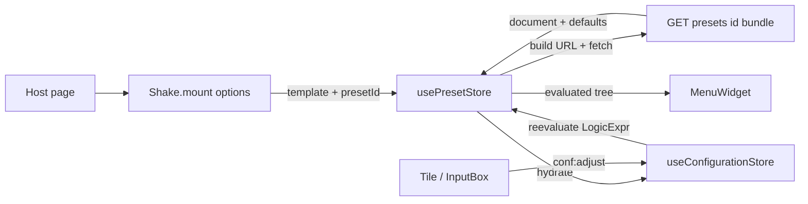

# CE — Preset integration

Load a **Preset bundle** into the Shake custom element (`apps/ce`): host bootstrap, dedicated preset store, configuration seed, menu from published tree, and **runtime** `isVisible` / `isEnabled` evaluation.

Related:

- [BE Preset & default entries](../../be/doc/db/preset.md) — entities, CE consumption contract
- [BE Board document](../../be/doc/db/board-document.md) — published `payload` / `LogicExpr`
- [BE API](../../be/doc/api/api.md) — `GET /presets/:id/bundle`
- [BE Script chunks & embeds](../../be/doc/db/script-embed.md) — host JS URL `GET /embeds/:id/bundle.js` (planned)
- [FE services](../../fe/doc/service/service.md) — `presetsService.getBundle` (admin); CE fetches with the same client pattern

---

## Goals

- Pass **API base + path template + preset id** from the host (not a single frozen URL).
- Fetch `{ preset, document, defaults }` into **`usePresetStore`**.
- Seed **`useConfigurationStore`** from `defaults`.
- Drive **MenuWidget** from the published document tree (no hardcoded mock).
- After every configuration change, **re-evaluate** `LogicExpr` on the tree and refresh `isVisible` / `isEnabled`.
- Switch preset at runtime via `presetId` without remounting.

## Non-goals (v1 polish)

- Embedding the full document in host HTML.
- Putting bootstrap fields into `useConfigurationStore`.
- Duplicating the bundle into every `widget.data`.
- Per-widget HTTP fetches of the same bundle.

---

## Three kinds of “configuration”

| Name | Owner | Shape | Role |
| ---- | ----- | ----- | ---- |
| **Bootstrap / host options** | `Shake.mount` | `apiBaseUrl`, `presetBundlePathTemplate`, `presetId` | Where + which preset to load |
| **Preset store** | Pinia | Bundle + source tree + evaluated tree + status | Document lifecycle; re-resolve visibility |
| **Configuration store** | Pinia | `Record<string, string[]>` | Runtime selection; seeds defaults, drives LogicExpr |



---

## 1. Host contract: template + id

```ts
export interface ShakeMountOptions {
  /** BE origin, e.g. `http://localhost:3000` (default). */
  apiBaseUrl?: string
  /**
   * Path template relative to `apiBaseUrl`.
   * Must include `{id}` — default `/presets/{id}/bundle`.
   */
  presetBundlePathTemplate?: string
  /** Preset id (bigint string). */
  presetId: string
}

export function mount(id: string, options: ShakeMountOptions): void

/** Switch preset during the session (rebuilds URL, refetch, re-seed). */
export function setPresetId(presetId: string): Promise<void>
```

Example:

```html
<script>
  Shake.mount('configurator', {
    apiBaseUrl: 'http://localhost:3000',
    presetBundlePathTemplate: '/presets/{id}/bundle',
    presetId: '1',
  })

  // later:
  // await Shake.setPresetId('2')
</script>
```

Runtime URL = `apiBaseUrl` + template with `{id}` replaced by `presetId`  
→ e.g. `http://localhost:3000/presets/1/bundle`.

Do **not** put these fields into the selection store.

### Host script URL (planned)

The **runtime JS** (IIFE that defines `Shake` / custom elements) is separate from the preset **JSON** bundle above.

| Concern | Today (dev / demo) | Planned |
| ------- | ------------------ | ------- |
| Script | `<script src="/shake.js">` (CE Vite build / `public/demo.html`) | `<script src="{apiBase}/embeds/{id}/bundle.js">` |
| Data | `GET …/presets/{id}/bundle` | Unchanged |

See [BE script-embed.md](../../be/doc/db/script-embed.md). Until the BE serves embeds, keep local `/shake.js` for demos.

---

## 2. HTTP (FE pattern)

Thin `fetch` client under `apps/ce/src/api/` (same ideas as FE `api/client.ts`):

- Configurable base URL (`setApiBaseUrl` from mount options)
- `api.get/post/patch/delete`, `ApiError`, JSON + **204**
- Preset service: `GET` path from template — `presetsService.getBundle(presetId)`

CORS: allow the CE origin on the BE (`CORS_ORIGINS` or defaults).

---

## 3. Preset store + configuration hydrate

`usePresetStore`:

| Field / method | Role |
| -------------- | ---- |
| `status` / `error` | `idle` \| `loading` \| `ready` \| `error` |
| `presetId`, path template | Current bootstrap |
| `preset`, `defaults`, `document` | Bundle payload |
| `sourceTree` | Unpublished evaluation input (`payload.tree` + LogicExpr) |
| `tree` | **Evaluated** `MenuNode` for the menu |
| `loadPreset(id)` | Fetch, adapt, hydrate config, evaluate |
| `reevaluate()` | Re-run LogicExpr with current configuration |
| `clear()` | Reset |

`useConfigurationStore.hydrate(map)` — replace entire selection map (used on preset load).

On `conf:adjust` → `set` → **`presetStore.reevaluate()`**.

---

## 4. Runtime `isVisible` / `isEnabled`

Published tree nodes carry `LogicExpr` (not booleans). CE evaluates against live configuration + flat `document.nodes` (for `selected` / `between` leaf lookups).

| After | Action |
| ----- | ------ |
| Bundle load | Evaluate once → `tree` |
| Each `conf:adjust` | `reevaluate()` → new `tree` |
| `setPresetId` | Full reload + hydrate + evaluate |

`null` expr → `true`. Menu skips `!isVisible` nodes; disabled nodes set `isEnabled: false` for controls.

---

## 5. Menu integration

- `MenuPlugin` registers `menu-widget` only (no `data.root`).
- `MenuWidget` reads `usePresetStore().tree` (+ loading / error).
- Adapter: `payload.tree` (`slug` / `props`) → `MenuNode` (`name` / `data`); map catalog `box` → CE `input-box`.

---

## Implementation checklist (first shot)

1. Host options + `setPresetId` + demo HTML
2. CE `api/` client (FE pattern) + presets service
3. `usePresetStore` + configuration `hydrate`
4. Document → MenuNode adapter + LogicExpr evaluate
5. Wire `conf:adjust` → reevaluate
6. MenuWidget from store; remove mock menu
7. Unit tests (path build, hydrate, selected expr, adapter)

---

## References

| Artifact | Path |
| -------- | ---- |
| Bundle (JSON) | `GET /presets/:id/bundle` |
| Host script (planned) | `GET /embeds/:id/bundle.js` — [script-embed.md](../../be/doc/db/script-embed.md) |
| Preset design | [preset.md](../../be/doc/db/preset.md) |
| LogicExpr | [board-document.md](../../be/doc/db/board-document.md) |
| FE client | `apps/fe/src/api/client.ts` |
| CE mount | `apps/ce/src/main.ts` |
